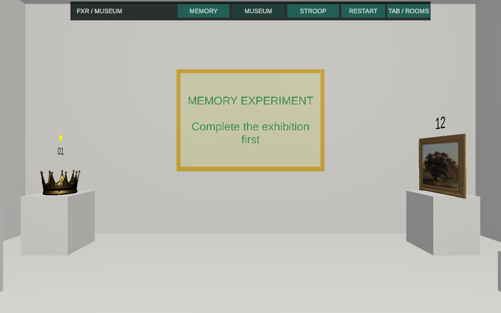
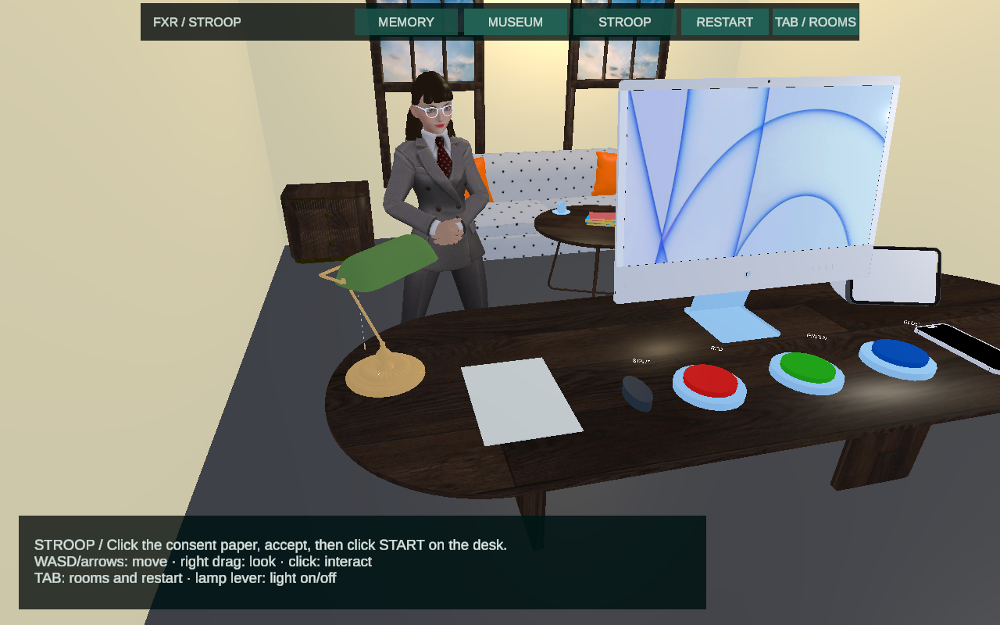
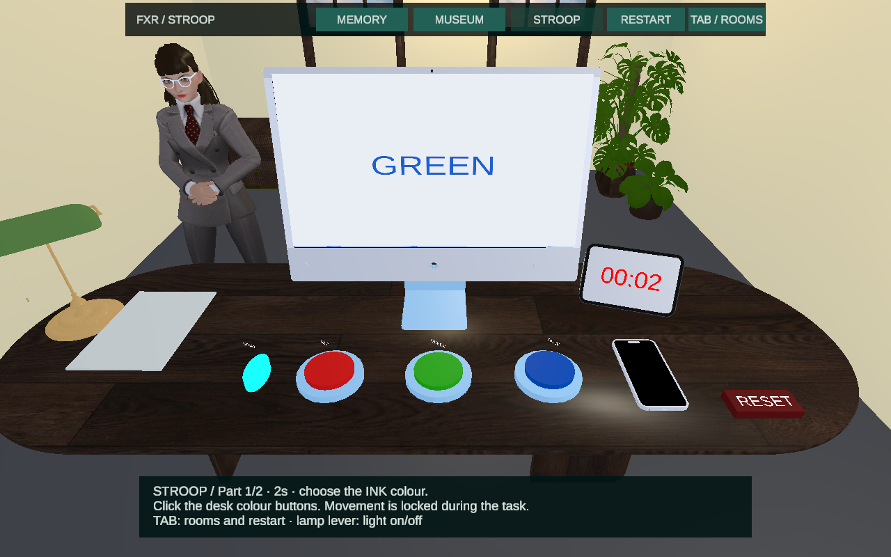
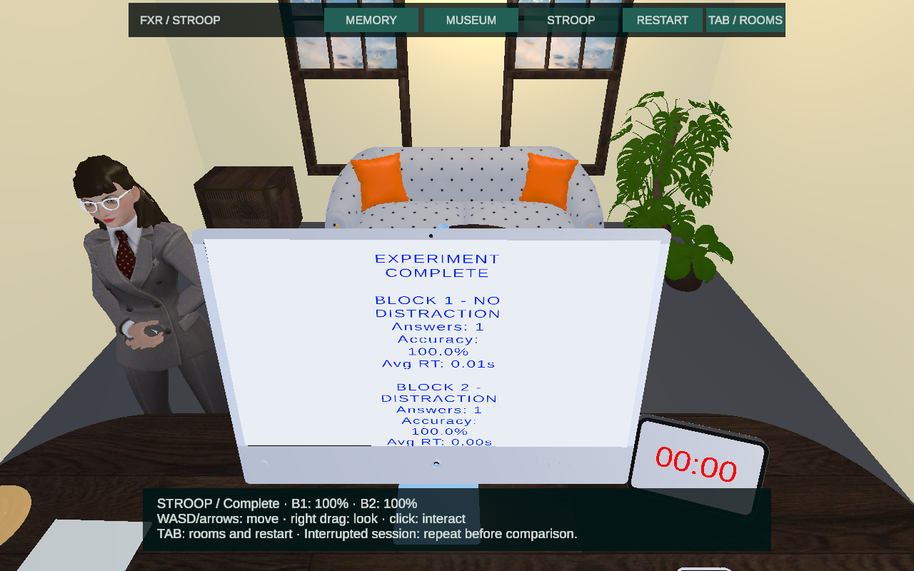
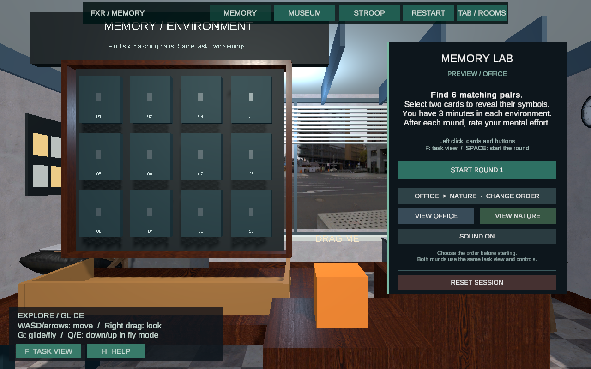
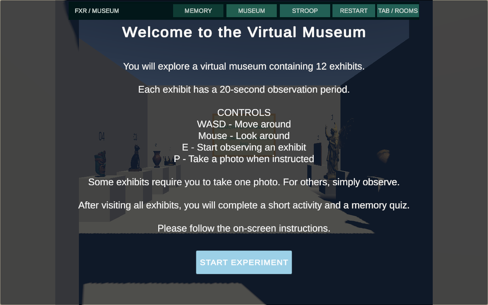
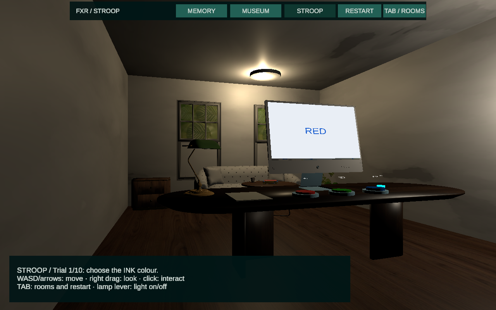

# 最新整合复查 — 2026-11-04

当前整合版位于 `integration/three-rooms-2026-11-01` / PR #2；本次不向 `aida-room`、`yuming-room2` 或 `main` 推送。应用版本 **0.6.0**，Unity **2022.3.62f3**。

## Aïda 最新版本

接入 `52ab70f`：两个各 30 秒的 Stroop 阶段、3 秒过渡，第二阶段手机通知；保留研究员语音、纸面拾起／释放物理、Start 全息提示、计时器、阶段结果和桌面 Reset。原先“固定 10 次答题”的说明与测试已按新流程更新。

更新源 Scene 的整合快照，重新绑定共享玩家、定点站位、移动锁定、纸面与音效相机。整个任务结束后恢复移动；菜单暂停覆盖计时、过渡、声音及音频调度。任务视角按显示器和颜色按钮重新取景，三个响应按钮都必须在可见范围，且完成后保留该视角。新 Reset 也改用统一的指针坐标，任务重置会允许再次播放结束语音；保留同意状态，公共 Restart 则恢复整间房。

## Yuming 更新审查

保留 `df270d7` / `760c23d` 的新键鼠输入、博物馆门／天花板／室内灯、视图光照、源 Scene 与整合 Prefab。MainScene 仍保留单共享玩家和单最终运行 Scene。新增进场后等待两秒的落地／可见性检查，覆盖记忆任务中途切换。

补修输入问题：导航点击不再重新锁定鼠标；拍照阶段的 UI／暂停菜单点击不再触发后台拍照；算术干扰阶段暂停时不再处理 Enter。Stroop 一次点击只锁定一个物体，防止 Start 自动站位时同一点击意外提交第一题。新增真实键鼠事件测试覆盖 E/P/Esc、点击切房按钮和暂停菜单误拍。这些修复只写入整合版。

本次还保留 Aïda 刚推到 `main` 的英文小组报告草稿（`9712916`），移至 `Docs/GROUP_REPORT_DRAFT_EN.md` 并从 README 链接；草稿的占位项／旧状态明确标出，现行运行说明保留。只将此文档提交读入整合分支，不向 main 推送。

## 验证

- 完整 PlayMode **10/10**、EditMode **2/2** 通过；最终定向整合 **4/4** 通过（`Logs/final-delivery-2026-11-04.xml`），涵盖正常拍照与菜单防误拍、Start 无误提交、按钮在视野内。最后完整回归为 `Logs/final-all-2026-11-04.xml`。
- 完成 Memory 原有全流程、Museum 12 展品／干扰／12 题／CSV 及保存后 Restart、Stroop 两阶段／通知／暂停／统计／两种 Reset。
- MainScene／MuseumRoom／StroopRoom 序列化资源 GUID 无缺失，Memory 源资源和 Packages 版本未变。源码约 **436 MiB**，无重复 GUID，无超过 95 MiB 的单个源文件。
- 自动化采用短计时和自动回答，只证明流程；不是参与者数据或心理效应证据。

第一次独立构建复查出现过博物馆空画面，后续重建后直接进入及记忆任务中途切换两条路径均显示正常；原因为何未稳定复现，未把它归因给组员改动。最终采用清缓存构建，Mac 独立程序 0.6.0 再次通过 Memory 运行中 → Museum 的切换、Start 及释放鼠标检查，博物馆地面、展品、灯光均正常显示。

原生 Mac 点击复查还完成：Memory 开始和选卡；Stroop 纸面／同意／START TASK、三种颜色按钮、真实的 30 秒 + 3 秒 + 30 秒流程、第二阶段手机闪光、最终分阶段成绩、Tab 暂停与恢复、公共 Restart 恢复未同意状态。该次每阶段各提交 3 个正确响应，只作功能检查；中途打开过菜单，界面正确标记为 interrupted session。主观音量／音色没有凭截图判定。检查的运行日志没有异常行。完整 Memory 和 Museum 实验由自动化覆盖，未在本次原生检查中逐项手动完成。

尚需真实 Windows 电脑首开／运行验证和两位作者的最终视觉确认。视频、教师权限、正式提交依然是单独交付步骤。

### 最新 Unity 渲染（自动化测试数据）

---

以下为 11 月 1 日版本的历史记录；旧固定答题次数与截图只代表当时版本。

# 三房间整合审查 — 2026-11-01

## 本次结果

预览位于独立分支 `integration/three-rooms-2026-11-01`，本机工作目录是 `/Users/yixiangli/Unity/FXR-Integration`。原 `/Users/yixiangli/Unity/FXR-Group-Project`、main、aida-room、yuming-room2 保留；不是在队友分支上重写。整合前已保存本地 Git bundle 备份。

用 **Unity 2022.3.62f3** 打开整合项目，选择 **FXR → Integration → Play three rooms**。Stroop 接受同意书并等它关闭后，可用下方 **START TASK** 或桌面实体 Start 开始。顶部切房；博物馆锁定鼠标时按 **Tab** 释放并打开菜单。Restart 重置当前房间，切房／重启都须确认；已保存 CSV 不删除。

## 如何满足共同 Scene 要求

老师 10 月 6 日邮件要求 one Unity project，三个房间由同一 Scene 连接。最终只打包 `Assets/Shared/Scenes/MainScene.unity`，运行中始终一个 Scene；三个房间通过快照 Prefab 在该 Scene 内启停和重建。采用 Prefab 是实施选择，不是老师指定的文件格式。

- Memory 保留原有源 Scene／Prefab，办公室与自然环境实验不重建。
- Yuming 源：`Assets/Rooms/RoomB/Scenes/RoomB.unity`；Aïda 源：`Assets/Rooms/AidaRoom/Scenes/AidaExperiment.unity`。
- 两个新快照在 `Assets/Integration/Prefabs/`。个人源 Scene 的布局修改需要重新同步快照，日常无需进入 Prefab Mode。
- 只有一个共享玩家、面向玩家的摄像机、AudioListener 和 EventSystem。Stroop 另保留显示器专用的离屏摄像机。

## 修复和边界

- 修正 Exhibit 脚本文件名与类名不一致，保留原 `.meta` GUID；导入房间重新绑定共享玩家与摄像机，保留原实验规则。
- 原 Standard 材质转换为现有 URP；未升级包或更换 Editor。
- 共享玩家保留物理碰撞，但放入 Ignore Raycast 层，避免源相机偏移时点击先命中自己；显示器离屏摄像机也关闭物理点击事件。
- 全局菜单冻结计时／音频并释放鼠标，取消恢复原状态；顶部导航保持可点击。切房重建整个实例，恢复 consent、控制器和物体。
- Memory 菜单中断沿用原记录；Museum 增加 interruption 列，取消菜单补偿 quiz 实时时钟。中断会话不宜直接与连续会话比较。
- Museum CSV 改用用户数据目录的 `MuseumResults`，避免写入只读安装目录。Memory CSV 保留原路径。Stroop 目前显示成绩／平均反应时间，未新增 CSV。
- Mac 独立程序诊断确认旧鼠标位置与 Input System 位置不一致；Stroop 纸面、实体按钮和灯具改用与共享 UI 相同的 Input System 坐标，保留原实验规则。
- Stroop 显示器的离屏 Canvas 关闭输入射线，避免看不见的显示界面吞掉同意书／桌面点击。保留 consent 门槛、实体 Start／颜色按钮和灯具控制；共享提示显示当前试次与完成成绩；增加清楚的 START TASK 入口，并区分接受后等待关闭／拒绝后需重启的状态。原模型的少量导入警告没有阻断运行，视觉仍应请房间作者复核。

## 已做检查

| 范围 | 结果 |
| --- | --- |
| 完整 PlayMode | 8/8 通过，包含记忆房原有完整流程／输入检查与三房间测试 |
| EditMode | 2/2 通过 |
| 三房间最终定向测试 | 3/3 通过，含纸面、实体 Start 及共享 START TASK 的实际 Input System 指针事件 |
| 点击遮挡 | 切房按钮第一命中、纸面物理射线与无离屏 UI 遮挡均通过 |
| Museum | 12 次观察、干扰、12 题、CSV、重启后文件保留 |
| Stroop | 未 consent 无法 Start；接受后完成 10 次响应；成绩与全房重置 |
| 共同运行环境 | 单 Scene／玩家输入／面向玩家摄像机／AudioListener／EventSystem |

自动化测试使用短时长和自动回答，仅证明流程。截图是 Unity 实际渲染，数值是测试数据，不能作为参与者研究结果。XML／日志在本机忽略目录 `Logs/integration-*`；渲染在 `Builds/Review/integration-*`。

Mac 独立程序 **0.5.0** 已成功构建并实际启动：公共菜单、Memory → Museum → Stroop、博物馆 Start／Tab 释放鼠标、Stroop 纸面／接受／START TASK／实体颜色响应均已操作检查。Stroop 取消 Restart 保留 Trial 2，确认 Restart 恢复未 consent 的初始状态。原实体 Start 的近距离指针检查由自动化覆盖；本机演示使用清楚的 START TASK。检查的 Player.log 没有异常行。本次没有手动走完 12×20 秒博物馆或 10 次 Stroop，完整流程由上述自动化测试覆盖。

资源静态审查：既有元数据 GUID 均保留，无重复 GUID／Windows 非法文件名；Memory 原源 Scene／Prefab 没有删除物体标识。源文件约 **651 MiB**，低于 2 GB；Packages 版本保持原样。

### 实际 Unity 渲染（自动化测试画面）

## 还需完成

1. 两位房间作者在整合分支确认自己的房间没有行为或视觉偏差；至少一位 Windows 组员用指定版本实际打开并运行一遍。
2. 在最终展示电脑检查字体、鼠标操作、音量和切房／Restart。记忆房可找 1–2 人做简短可用性试用；鼠标拖拽物体需要真人复核。
3. 填全三人英文姓名，确认实际贡献，准备压缩演示视频。演示视频／正式提交尚未完成。
4. 源项目小于 2 GB；安排老师访问私有仓库，按要求邮件提交链接。Ch5 p.2 的最新已核验截止为 **11 月 4 日午夜前**；本次没有重查后续公告。
5. PDF 的 touch-pad 原文与课堂键鼠替代方式仍有待课堂口径确认。现有主要交付按组内键鼠约定进行；没有 Windows 实机或头显测试，也没有证实环境会产生心理效应。
