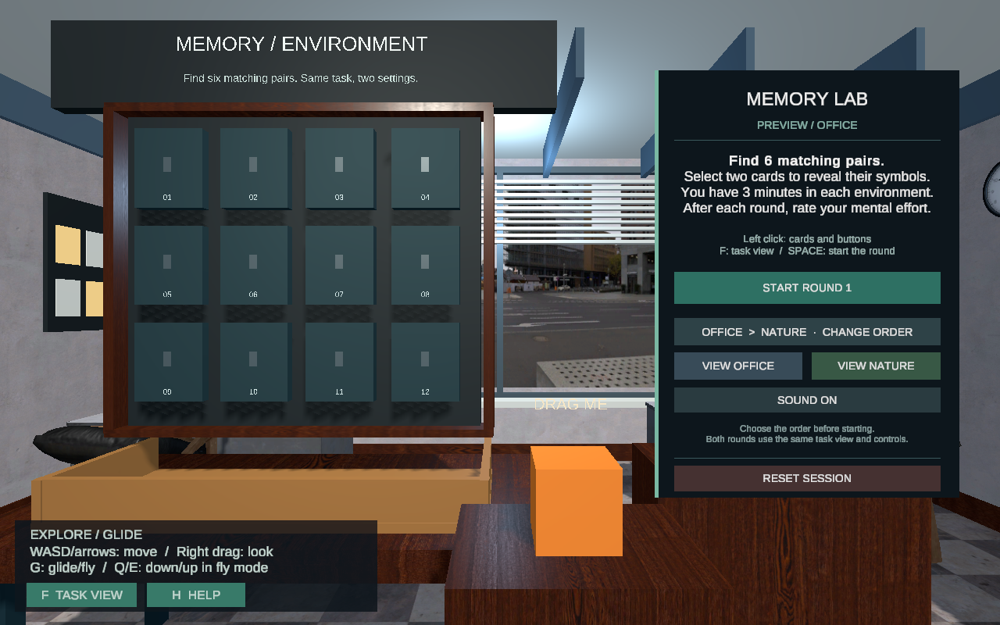
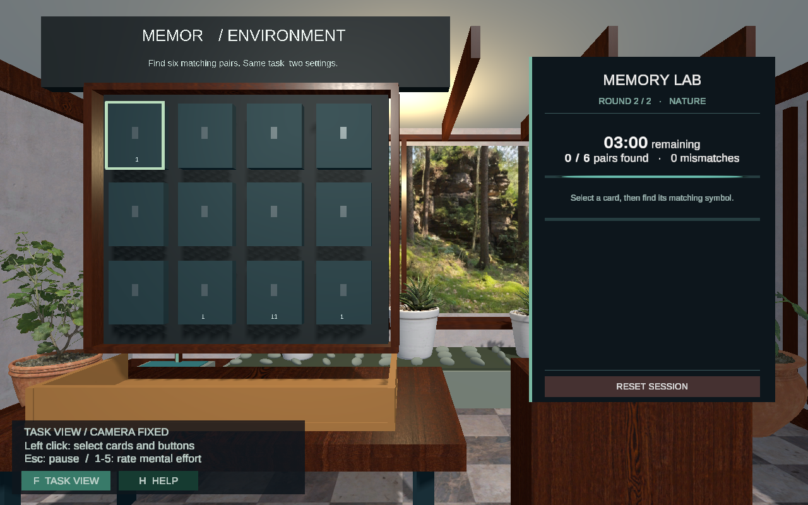
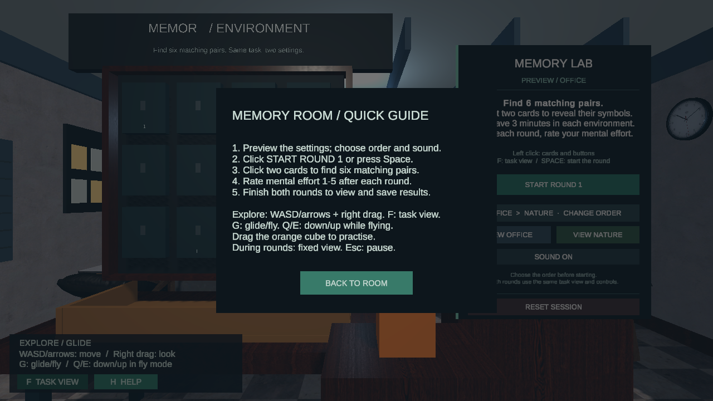

> 2026-11-01：以下为记忆房的历史专项检查。当前三房间整合与交付状态见 [整合审查](INTEGRATION_REVIEW_CN.md)。

# Memory Room：桌面操作、UI 与作业要求复查

更新：2026-10-14。范围是 Yixiang 的房间；主要交付键盘／鼠标桌面版本。组内最新说法不使用 Quest，但这不是老师新邮件独立确认的设备豁免。

## 本轮操作与 UI 改动

| 问题或需求 | 已实现的处理 |
| --- | --- |
| 开始时不容易找到合适视角 | 默认对齐任务；F 和 TASK VIEW 回到相同视角；开始每轮自动对齐 |
| 自由走动会改变两轮的观察条件 | 两轮及评分／过渡阶段固定移动与视角；任务外可探索 |
| 键鼠提示混有 VR 手柄说明 | 桌面专用控制条、H 帮助、明确的当前状态；提示随键盘布局显示 |
| 高帧率时小步移动被忽略 | CharacterController 的 minMoveDistance 在运行时设为 0；实际模拟输入检查了飞行 |
| 滑行／飞行不够明确 | G 切模式，WASD 或方向键移动，飞行时 Q/E 垂直移动；正式任务中锁定 |
| 缺少明确的物体 manipulation 演示 | 独立橙色练习方块：鼠标射线按住拖动、松开恢复物理；正式任务时不能拖动 |
| 暂停与切到其他窗口的处理 | Esc 暂停，失焦暂停；倒计时和配对动画都停；中断轮次标记 |
| 容易误点新会话或 Reset | NEW SESSION / RESET 先确认；Cancel 保留当前结果；Reset 不删除已保存 CSV |
| 完成后不知道数据在哪里 | 自动保存、CSV FOLDER 按钮打开目录；记录输入模式和 0.4.0 版本 |
| 背景灯光缺少明确的互动控制 | 新增短距离背景补光随条件切换颜色／强度；任务灯和牌面保持一致 |
| UI 文字与布局 | 加大任务说明；帮助／暂停采用屏幕面板；检查主要阶段、按钮射线和文字溢出 |
| 整合容易改变资源标识 | 在已有 Prefab 内做增量更新；旧 GameObject／组件标识全部保留，只新增 21 个对象文档 |

现有 Poly Haven 家具／植物／摄影材质与 Freesound 真实录音沿用。两轮没有在界面上被描述为“更轻松／更好”；两个评分完成前不展示对比结果。

## 老师要求对照

原文见 [Mini-project brief](Assignment/2026-FXR-MiniProject.pdf) 和 [Marking rubric](Assignment/Project-Assessment%20Criteria%20with%20Marking%20Rubric.pdf)。老师 10 月 6 日邮件已核验：一个 Unity 项目，通过同一个场景连接三人的房间。

| 要求 | 本房间状态 / 演示方式 |
| --- | --- |
| 虚拟环境建模 | 已有办公室／自然环境、免费模型和原创建筑 |
| Touch pad + gliding/flying | 键鼠等效滑行／飞行已实现；touch pad 的字面要求如何对应键鼠仍待课堂确认。可选 XR simulator/rig 保留 |
| Ray casting 远距 manipulation 或近距 virtual hand | 鼠标射线选牌、拖动练习方块；采用前一种方案 |
| Activation / Deactivation | 环境装饰、牌面／符号、设置／评分／结果面板随阶段开关 |
| Canvas + 3D TextMeshPro | 世界空间任务面板、屏幕帮助／暂停、房间 3D 标题及练习提示 |
| Physics | 匹配卡片落入收集盒；练习方块刚体／碰撞／释放 |
| Lighting controlled during interaction | 预览与换条件控制背景补光；任务灯恒定 |
| 3D audio | 真实空间键盘／溪流细节和任务提示声；环境底声与淡入淡出 |
| Countdown timer | 两轮各 180 秒；暂停／失焦／Reset 弹窗正确暂停 |
| Scripting / logic | 洗牌、配对、超时、评分、重置、CSV 与中断记录 |
| 每项可 Reset | 恢复牌、计时、评分、练习物体、任务视角和所选首轮环境；保留选定顺序／声音与旧 CSV |
| 一项目、同一连接场景 | 本房间已在 MainScene；另两房间还是初始模板，整合未完成 |
| README 名字／贡献／功能／操作 | 功能与操作已更新；两位组员全名、房间分配与实际贡献仍待补 |
| 演示视频在仓库 | 尚缺完整三房间视频，等整合后录制 |
| 源项目小于 2 GB | 以 Git 中的 Assets / Packages / ProjectSettings / Docs 为准；不含 Library / Builds / Logs 等缓存 |
| 可分享仓库与发送链接 | 私有仓库已同步；老师访问权限和最终发送仍待提交阶段处理 |

截止：2026-10-22（周四）午夜前。评分表强调功能可靠、迭代有依据和英文说明清晰；以上检查不构成分数保证。

## 验证与边界

最新自动检查和构建结果见 [STATUS](STATUS.md)。已检查真实模拟鼠标拖方块、点卡片、键盘导航／开始／评分、暂停／失焦、两个完整回合、重置、新会话确认、CSV、按钮定位与文字溢出。主要 UI 在 1280×720、1280×800、1920×1080 的相机渲染中复查。相机渲染来自自动检查，不是参与者研究或 Windows 实测。

本轮不重建房间，不改队友场景／资源，不改 Unity 或包版本。组员 Windows 的首次实际运行仍需一次验证；3D 音效主观音量还需用真实耳机试听。此桌面版本不声称验证沉浸式 VR 心理效应。

### Mac 独立程序前台复查

用户解锁后，已通过真实鼠标／键盘完成办公室和自然两轮六对匹配；检查了键盘／鼠标评分、结果页、自动 CSV、CSV FOLDER 打开 Finder、帮助返回、G/E 飞行和 F 任务视角。Esc 暂停后计时保持 02:53，重置确认／取消保留暂停状态；确认重置恢复初始状态。NEW SESSION 先确认，取消保留两轮结果，确认后恢复办公室预览，已保存 CSV 仍存在。此次 CSV 仅为助理操作检查数据，已归档到本地忽略目录，不是参与者结果；原有 CSV 未删除。运行日志未见异常行。

界面工具的拖动尝试没有产生可见方块位移，因此不把独立程序的拖动记为通过；MainScene 中的模拟拖动测试已通过，真人试用时还需验证该项。声音主观感受和 Windows 实机仍待检查。

## 我的房间还需要什么

1. 建议找 1–2 人各完成一次两轮，确认他们能独立理解操作、读字、听声音，并尝试拖动橙色练习方块；反馈由助理继续修复。这是可用性试跑，不是正式心理研究。
2. 一位 Windows 组员打开新版并运行一次；无需你手动搭建模型或配打包参数。
3. 全组确认键鼠导航的课堂要求，完成另外两房间，补全名字与实际贡献，再录最终视频和安排老师访问。

当前无需再加第三环境、换素材网站或安装 Rider。日常用 **FXR → Desktop → Play Memory Room**；房间开发源仍是 MemoryDev，最终入口仍是 MainScene。

## 已检查的桌面界面

以下为 Mac 编辑器自动检查中的相机渲染，展示当前布局，不代表 Windows 或参与者实测。

